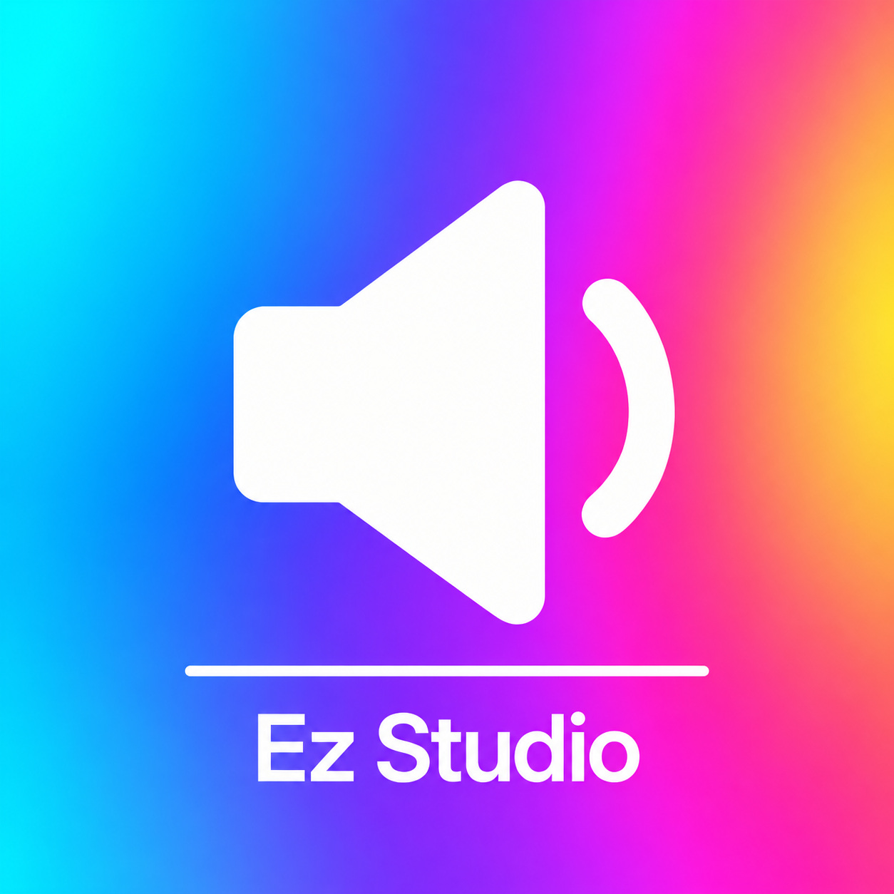

# Ez Audio Control

A lightweight macOS menu bar volume control for your current audio output, with a slider, volume keys and a compact HUD.

[简体中文](README.md) · [MIT license](LICENSE) · [Privacy](PRIVACY.md) · [Contributing](CONTRIBUTING.md)

## Why I built this

**After connecting my Mac mini to a monitor, I could no longer adjust the macOS system volume.** That is the fundamental reason I built Ez Audio Control.

Audio played normally, but the familiar volume keys, mouse volume actions and system volume control were unavailable. This one everyday frustration is what I wanted to solve.

Many existing tools can solve it and offer powerful display management or audio processing features. Someone who only wants volume control back may not need those extras, or want to buy a whole application just for that one purpose.

So I decided to build a **free, open-source tool focused on volume control and kept as lightweight as possible**. The goal is to make this small task simple again: connect a monitor and keep adjusting volume with familiar keys, mouse actions and a menu bar slider.

See [community discussions and common approaches (Chinese)](Docs/BACKGROUND.md). Free alternatives already exist; this project aims to offer a lightweight choice focused on this one problem.

## Features

- Left-click for volume and output devices, with a separate Sound Settings entry at the bottom.
- Native volume when available; automatic software attenuation for compatible outputs without writable system volume. No driver installation.
- Volume keys and mouse actions mapped to system volume commands, with a top HUD.
- Paired Bluetooth audio devices; connect and select one only after an explicit click.
- HUD, menu bar numbers or both; English and Simplified Chinese follow system language.
- Optional volume feedback and launch at login. Software feedback follows confirmed gain.

Software volume is attenuation only: 100% preserves the incoming audio, 0% is silence. It does not change the monitor or external speaker's physical volume.

## Status and requirements

**0.1.44 development-preview source.** This repository currently provides no notarized release download. A local build is a development artifact.

| Item | Requirement or limit |
| --- | --- |
| Architecture | Apple Silicon; no Intel App build |
| Runtime | macOS 14+ target; software volume needs macOS 14.2+ and a compatible output format |
| Build tools | Apple toolchain with macOS 27 SDK, `swiftc`, `clang` and `codesign` |
| Dependencies | Apple system frameworks only |
| Validation | Development hardware, fake-device tests and component checks; not universal compatibility |

Long-running and sleep/wake recovery are still under observation. Cleanup or recovery can briefly interrupt audio. Software attenuation is not a physical volume ceiling or protection against every failure. Pause playback and lower external speaker volume before first use.

The retained DDC bridge uses private IOAVService/CoreDisplay APIs, which may change with macOS. Mac App Store distribution is not promised.

## Build from source

```sh
./scripts/build.sh --adhoc
./scripts/test-offline.sh
```

Output: `dist/0.1.44/Ez Audio Control.app`. Building and offline tests do not launch the App, install a driver, write device volume or request audio capture. Ad-hoc signing is for local development, without a distribution identity or Apple notarization. Use `--unsigned` to compile only.

Open the App yourself after building. Keep one installation path and a consistent signing identity where possible; changed development signatures may require permission updates. Do not modify TCC or disable system security to work around permissions.

## Usage and permissions

1. Left-click for volume/output selection. Right-click for display mode, feedback and login settings.
2. Volume keys require a user-granted control permission: Device Control and Data Access on newer systems, Accessibility on older systems. The App links to the relevant page.
3. Outputs without writable native volume trigger an attempt at software mode. You decide the first macOS system-audio-capture prompt. No physical microphone is opened and no audio is saved.
4. Bluetooth permission is requested through an explicit Bluetooth action. The App does not scan or pair new devices automatically.

Run one copy of the App. Review support information copied from About before sharing it.

## Development and license

See [architecture](Docs/ARCHITECTURE.md), [contributing](CONTRIBUTING.md), [releasing](Docs/RELEASING.md) and [security reporting](SECURITY.md). Include the version, OS, connection type and reproduction steps in bug reports; exclude full system logs, serial numbers and recordings.

Original project code and documentation are [MIT-licensed](LICENSE), credited to **Ez Studio (Jeson)**. DDC adaptations retain the complete m1ddc and MonitorControl notices; see [THIRD_PARTY.md](THIRD_PARTY.md). The App icon is an AI-assisted project asset. macOS symbols and feedback audio are not redistributed.
